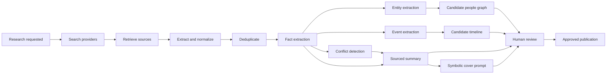
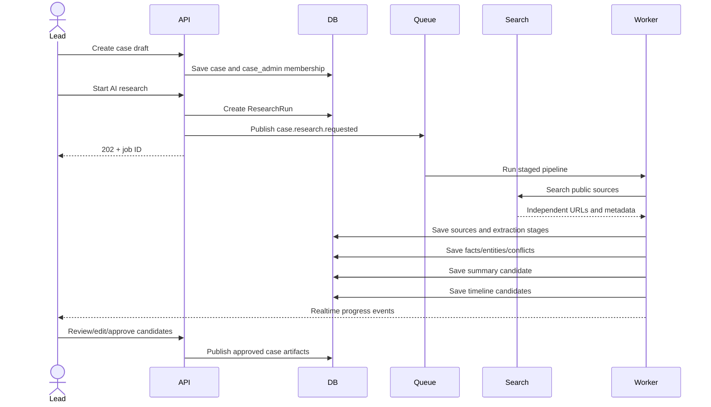
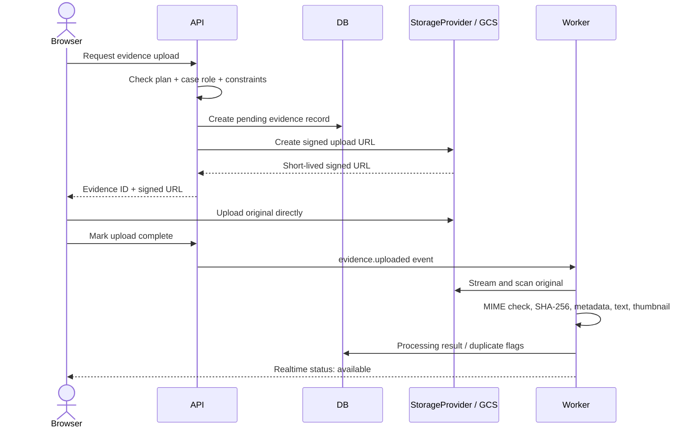
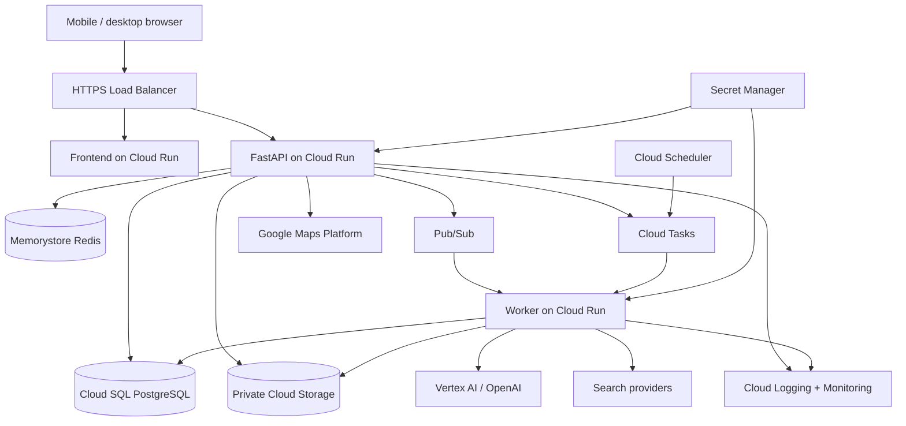

# EILLEN Architecture

## Product and system overview

EILLEN is a mobile-first collaborative investigation workspace. It represents cases as structured, attributable records: sources support summaries and events; evidence remains immutable; user notes and theories remain distinguishable from verified facts; and AI output stays in a review queue until a person approves it.

The monorepo contains a React web client, an async FastAPI API, PostgreSQL, Redis, and a worker. Domain services own authorization and business rules. Route handlers validate transport data and call services. Infrastructure concerns such as storage, search, events, email, and AI are accessed through interfaces so Google Cloud implementations can replace local adapters without changing domain logic.

The initial Phase 1 slice includes account registration, login, rotating refresh-token sessions, logout, a current-user endpoint, database-driven plans and permissions, Alembic migrations, and a responsive application shell. Later phases extend this foundation vertically.

## Proposed repository tree

```text
eillen/
├── backend/
│   ├── alembic/
│   ├── app/
│   │   ├── auth/                 # credentials, sessions, routes, dependencies
│   │   ├── users/                # users and profiles
│   │   ├── subscriptions/        # plans, grants, subscriptions, permission service
│   │   ├── cases/ summaries/ notes/ timeline/
│   │   ├── evidence/ discussions/ maps/ people/ invitations/
│   │   ├── research/ ai/ moderation/ notifications/
│   │   ├── storage/ events/ workers/
│   │   ├── common/ config/ db/
│   │   └── main.py
│   ├── tests/
│   ├── alembic.ini
│   ├── Dockerfile
│   └── pyproject.toml
├── frontend/
│   ├── public/
│   ├── src/
│   │   ├── app/ routes/ components/ features/
│   │   ├── hooks/ lib/ services/ state/ styles/ types/
│   │   └── main.tsx
│   ├── Dockerfile
│   └── package.json
├── infra/
│   └── terraform/                # introduced alongside deployable cloud resources
├── ARCHITECTURE.md
├── README.md
├── docker-compose.yml
└── Makefile
```

Folders are added when their vertical slice is implemented; empty domain scaffolds are intentionally avoided.

## Database entity model

Core relational data stays normalized. JSONB is reserved for snapshots, provider metadata, extracted attributes, and audit before/after state. UUID primary keys prevent sequential identifier exposure. Authorization always resolves the authenticated user, active subscription grants, and case membership on the server.

```mermaid
erDiagram
  USER ||--|| USER_PROFILE : has
  USER ||--o{ USER_SUBSCRIPTION : receives
  SUBSCRIPTION_PLAN ||--o{ USER_SUBSCRIPTION : selected_by
  SUBSCRIPTION_PLAN ||--o{ PLAN_PERMISSION : grants
  PERMISSION ||--o{ PLAN_PERMISSION : included_in
  USER ||--o{ REFRESH_SESSION : authenticates

  USER ||--o{ CASE : creates
  CASE ||--o{ CASE_MEMBER : has
  USER ||--o{ CASE_MEMBER : joins
  CASE ||--o{ CASE_INVITATION : invites
  CASE ||--o{ CASE_SUMMARY : summarizes
  CASE_SUMMARY ||--o{ CASE_SUMMARY_REVISION : versions
  CASE ||--o{ CASE_NOTE : contains
  CASE ||--o{ SOURCE : cites
  CASE ||--o{ TIMELINE_EVENT : orders
  TIMELINE_EVENT ||--o{ TIMELINE_EVENT_SOURCE : supported_by
  SOURCE ||--o{ TIMELINE_EVENT_SOURCE : supports
  CASE ||--o{ EVIDENCE : stores
  EVIDENCE ||--o{ EVIDENCE_ANNOTATION : annotates
  CASE ||--o{ DISCUSSION_THREAD : discusses
  DISCUSSION_THREAD ||--o{ DISCUSSION_POST : contains
  CASE ||--o{ LOCATION : maps
  CASE ||--o{ ENTITY : contains
  ENTITY ||--o| PERSON : specializes
  ENTITY ||--o{ ENTITY_RELATIONSHIP : origin
  ENTITY ||--o{ ENTITY_RELATIONSHIP : target
  CASE ||--o{ RESEARCH_RUN : researches
  RESEARCH_RUN ||--o{ RESEARCH_STAGE : persists
  RESEARCH_RUN ||--o{ AI_ARTIFACT : produces
  USER ||--o{ NOTIFICATION : receives
  USER ||--o{ REPORT : files
  REPORT ||--o{ MODERATION_ACTION : resolves
  USER ||--o{ AUDIT_LOG : acts
```



The first migration creates the Phase 1 entities shown at the top. Subsequent migrations introduce the remaining entities with their domain slice.

## Permission model

Guests receive read-only access to public cases. Manual public cases are unlimited; AI-assisted, imported, and private cases use a weekly allowance of one for free accounts or five for paid accounts. My Notes and My Timeline are private per-user workspaces. Free accounts can open them read-only, while write access requires a paid plan. The allowance resets Monday at 00:00 UTC. UI capability hints come from the API but never replace server-side checks.

| Permission | Free | Investigator | Lead Investigator | Admin |
|---|:---:|:---:|:---:|:---:|
| `case.read_public` | ✓ | ✓ | ✓ | ✓ |
| `case.create` | 1/week | 5/week | 5/week | ✓ |
| `case.edit` | ✓ | ✓ | ✓ | ✓ |
| `case.invite` | ✓ | ✓ | ✓ | ✓ |
| `discussion.read` | ✓ | ✓ | ✓ | ✓ |
| `discussion.write` | ✓ | ✓ | ✓ | ✓ |
| `evidence.read` | ✓ | ✓ | ✓ | ✓ |
| `evidence.upload` | ✓ | ✓ | ✓ | ✓ |
| `timeline.read` | ✓ | ✓ | ✓ | ✓ |
| `timeline.write` |  | ✓ | ✓ | ✓ |
| `notes.write` |  | ✓ | ✓ | ✓ |
| `timeline.approve` | ✓ | ✓ | ✓ | ✓ |
| `people.write` | ✓ | ✓ | ✓ | ✓ |
| `ai.research` | ✓ | ✓ | ✓ | ✓ |
| `ai.generate_summary` | ✓ | ✓ | ✓ | ✓ |
| `ai.generate_timeline` | ✓ | ✓ | ✓ | ✓ |
| `admin.access` |  |  |  | ✓ |

Case role grants refine access after the plan check:

| Capability | Viewer | Contributor | Editor | Case Admin |
|---|:---:|:---:|:---:|:---:|
| Read private case | ✓ | ✓ | ✓ | ✓ |
| Add posts, notes, evidence, suggestions |  | ✓ | ✓ | ✓ |
| Approve timeline, edit summary and graph |  |  | ✓ | ✓ |
| Manage collaborators, research, privacy, publication |  |  |  | ✓ |

Limits such as active cases, monthly AI runs, bytes stored, and collaborators are fields on `subscription_plans`; services enforce them transactionally.

## API surface

All endpoints are rooted at `/api/v1`. Errors use `{ "error": { "code", "message", "details", "request_id" } }`. Every collection endpoint must be paginated rather than returning an unbounded list. Activity streams use opaque cursor pagination; searchable directories and admin tables use page pagination with `items`, `page`, `page_size`, `total`, `total_pages`, `has_next`, and `has_previous` metadata.

| Area | Endpoints |
|---|---|
| Auth | `POST /auth/register`, `/auth/login`, `/auth/refresh`, `/auth/logout`; password reset and email verification request/confirm endpoints |
| Users | `GET /users/me`, `PATCH /users/me`, `POST /users/me/deletion-request` |
| Plans | `GET /subscriptions/plans`, `GET /subscriptions/me` |
| Cases | `GET/POST /cases`, `GET/PATCH /cases/{id}` |
| Summary and notes | `/cases/{id}/summary`, `/cases/{id}/summary/revisions`, `/cases/{id}/notes` |
| Timeline | `/cases/{id}/timeline`, `/cases/{id}/my-timeline`, `/cases/{id}/timeline/{event_id}/approve` |
| Evidence | `/cases/{id}/evidence`, `/evidence/{id}`, `/evidence/{id}/upload-complete` |
| Discussion | `/cases/{id}/discussions`, `/discussions/{id}/posts` |
| Map and graph | `/cases/{id}/locations`, `/cases/{id}/people`, `/cases/{id}/relationships` |
| Collaboration | `/cases/{id}/invitations`, `/invitations/{token}/accept` |
| Research and jobs | `/cases/{id}/research`, `/jobs/{id}` |
| Notifications | `/notifications`, `/notifications/{id}/read` |
| Admin | `/admin/users`, `/admin/cases`, `/admin/reports`, `/admin/plans` |
| Realtime | `WS /ws/cases/{id}`, `WS /ws/notifications` |

Mutating cookie-authenticated requests require a matching CSRF cookie and `X-CSRF-Token` header. Access and refresh tokens are HTTP-only, SameSite=Lax cookies. Refresh tokens rotate and are stored only as hashes. Logout revokes the session.

## Case creation and AI research pipeline

Each stage writes an independent `ResearchStage` record and durable artifact. Failed stages can resume without discarding earlier source records. Search and retrieval establish sources before any model receives content. Generated facts, entities, events, and relationships carry source IDs and remain candidates until approval.





Provider interfaces are `SearchProvider`, `SourceRetriever`, `LLMProvider`, and `ImageGenerationProvider`. Provider selection comes from environment settings. Prompt outputs use schemas; provenance validation rejects citations to unknown source IDs. The platform stores model/provider, input metadata, token usage, status, timestamps, and safe errors without storing hidden reasoning.

## Evidence upload sequence



Original objects are private and immutable. Downloads and uploads use short-lived signed URLs. Public derivatives strip unsafe metadata. Local development uses `FakeGCSStorageProvider` with the GCS emulator; production uses `GoogleCloudStorageProvider`. A future S3 adapter can implement the same interface.

AI-generated case covers use the same provider. Workers upload versioned WebP objects under `cases/{case_id}/covers/`, save the private object key in PostgreSQL, and expose a stable case-cover endpoint that checks case visibility before redirecting to a short-lived storage URL. Regeneration creates a new object and removes the superseded object after the database update succeeds.

## Google Cloud deployment architecture

The implementation sequence, current readiness gaps, environment layout, and launch checklist are maintained in [DEPLOYMENT_PLAN.md](DEPLOYMENT_PLAN.md).



Cloud Run instances remain stateless. Cloud SQL owns relational state, Memorystore handles cache/rate limits/ephemeral realtime fan-out, GCS owns binary objects, and Pub/Sub carries durable domain events. Cloud Tasks handles controlled retries and scheduled HTTP work. Domain event and provider ports keep these services outside core domain logic.

The scheduled content jobs run once per week on Monday in UTC. Cloud Scheduler invokes the recent-case Cloud Run Job at 01:00 (`0 1 * * 1`), historical cases at 02:00 (`0 2 * * 1`), paranormal cases at 03:00 (`0 3 * * 1`), and YouTube Shorts at 04:00 (`0 4 * * 1`). Terraform defines these schedules in `infra/environments/staging/scheduled_cases.tf` and `scheduled_reels.tf`. See [scheduled cases](docs/scheduled-cases.md) and [scheduled reels](docs/scheduled-reels.md) for activation and retry behavior.

## Implementation phases

1. **Foundation:** monorepo, containers, database, Redis, FastAPI, React, auth sessions, plans and permission service, migrations, responsive shell, tests and operational docs.
2. **Cases and collaboration:** cases, public/private access, membership, invitations, case overview, mobile case navigation, limits and audit events.
3. **Knowledge and provenance:** sources, versioned summaries, investigator notes, visibility, citation rendering and revision history.
4. **Timeline:** source-linked candidate events, precision and verification states, review/approval flow and mobile details sheet.
5. **Evidence:** storage interface, local and GCS adapters, signed direct uploads, validation pipeline, immutable originals and gallery.
6. **Discussion:** case threads, replies, mentions, reports, source-oriented reactions and realtime updates.
7. **Maps:** sourced locations, privacy-aware precision, Google Maps adapter and mobile full-screen map.
8. **People graph:** entities, relationships, candidate approval, automatic layout and touch-first graph interaction.
9. **AI research:** resumable pipeline, provider adapters, source retrieval, extraction, conflicts, summaries, timeline, graph and safe cover art.
10. **Operations and trust:** notifications, moderation, full audit coverage, search, observability, quotas, security review and production deployment.

Each phase includes its database migration, API, mobile UI, authorization, audit coverage, and focused tests so the application remains usable at every boundary.
