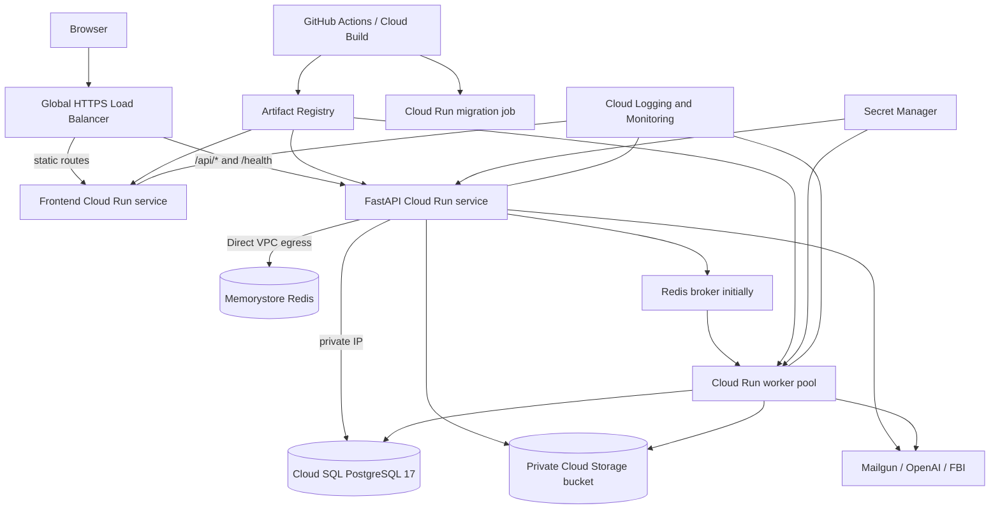

# Google Cloud deployment plan

## Goal and initial assumptions

Deploy EILLEN first to a private staging environment, prove migrations, uploads, email, AI jobs, and rollback, then promote the same artifacts to production.

Initial defaults until product requirements say otherwise:

- Region: `us-central1`, with every regional resource colocated.
- Separate Google Cloud projects for staging and production.
- One public origin per environment, such as `staging.example.com` and `app.example.com`.
- Infrastructure managed with Terraform and application delivery through GitHub Actions using Workload Identity Federation.
- PostgreSQL remains the system of record, Redis remains ephemeral infrastructure, and uploaded files remain private in Cloud Storage.

Region, domains, and the production availability target are decision gates before infrastructure is applied.

## Current setup status

- Google Cloud project display name: `case-theory` (created).
- Google Cloud project ID: `case-theory` (confirmed).
- Google Cloud project number: `1062432609767` (confirmed).
- Billing: enabled and linked (confirmed).
- Foundational APIs: enabled and managed by Terraform (Artifact Registry, Billing Budgets, Cloud Resource Manager, Compute Engine, IAM, IAM Credentials, Memorystore, Cloud Run, Secret Manager, Service Networking, Cloud SQL Admin, and Cloud Storage).
- Environment: staging (confirmed).
- Region: `us-central1` (confirmed).
- Local tools: repository-local Terraform 1.14.7 and Google Cloud SDK 586.0.0 are installed under the ignored `.tools` directory and exposed through project wrappers.
- Terraform foundations: implemented and validated with Terraform 1.14.7 and Google provider 7.46.1.
- Terraform state bootstrap: applied. Bucket `case-theory-tf-state` has public-access prevention, uniform bucket-level access, versioning, and deletion protection.
- Bootstrap state: migrated to `gs://case-theory-tf-state/bootstrap/default.tfstate`; a live refresh reports no changes.
- Staging foundation: applied. Artifact Registry, the $50 monthly budget, VPC and private service networking, the private evidence bucket, runtime identities, empty secret containers, and least-privilege IAM bindings are present. A live refresh reports no changes.
- Data and runtime services: Cloud SQL, Memorystore, Cloud Run, and secret values have not been created.

The following Cloud Shell bootstrap has been completed:

```bash
export PROJECT_ID="case-theory"
gcloud config set project "$PROJECT_ID"
gcloud services enable \
  artifactregistry.googleapis.com \
  compute.googleapis.com \
  iamcredentials.googleapis.com \
  redis.googleapis.com \
  run.googleapis.com \
  secretmanager.googleapis.com \
  servicenetworking.googleapis.com \
  sqladmin.googleapis.com \
  storage.googleapis.com
```

Enabling APIs does not create the Cloud SQL, Redis, Cloud Run, or load-balancer resources. Those resources should be created later through Terraform after their sizes and expected baseline cost are reviewed.

Project bootstrap through API enablement is complete. Project `case-theory` is the staging project and its regional resources will use `us-central1`.

## Recommended architecture



The load balancer keeps the browser, cookies, CSRF flow, frontend, and API on one origin. It routes `/api/*` and `/health` to the API and all other paths to the frontend. This avoids cross-site cookie configuration and removes the Docker-only `backend:8000` dependency from the production Nginx configuration.

Cloud Run services provide the frontend and API. Cloud SQL uses private IP. API and worker traffic reaches Cloud SQL and Memorystore through Direct VPC egress, which Google recommends for Cloud Run-to-Memorystore connectivity. The evidence bucket uses uniform bucket-level access and is never public.

The current Celery process is a continuous, non-HTTP consumer. A Cloud Run worker pool matches that runtime model, but worker pools are currently exposed through the beta `gcloud` surface. Use one worker-pool instance for staging. Before production launch, make an explicit choice:

1. **Recommended:** replace Celery dispatch with authenticated Cloud Tasks HTTP handlers on a private Cloud Run worker service. This removes the continuously running worker and Redis broker dependency.
2. Keep Celery on a Cloud Run worker pool and accept the beta product dependency.
3. Run Celery on a small managed-instance-group VM, accepting patching and process-supervision work.

Do not run the current Celery command as a normal Cloud Run service: it does not listen on the required HTTP port.

## Environment layout

| Concern | Staging | Production |
|---|---|---|
| Project | Dedicated staging project | Dedicated production project |
| Cloud Run frontend/API | Scale to zero is acceptable | API minimum instance based on latency target |
| Cloud SQL | Single-zone, smallest tested shape | HA when availability requirements justify it |
| Database recovery | Automated backups and PITR | Automated backups, PITR, deletion protection, restore drill |
| Memorystore | Basic tier | Standard tier if Celery remains |
| Worker | One worker-pool instance | Cloud Tasks preferred; otherwise explicit worker-pool approval |
| GCS | Separate private bucket | Separate private bucket, retention/lifecycle policy |
| Domain | Staging subdomain | Production application domain |
| Secrets | Separate secret values | Separate secret values and restricted access |

## Required application changes

### 1. Separate migrations from API startup

The Compose command currently runs `alembic upgrade head` and database seeding before Uvicorn. Cloud Run may start several instances concurrently, so production API startup must only start Uvicorn.

Create a Cloud Run Job from the backend image with this release command:

```text
alembic upgrade head && python -m app.db.seed
```

The delivery pipeline runs the job once before shifting traffic to a new API revision. A failed migration stops the release. Schema changes must remain backward-compatible with the previous API revision during rollout.

### 2. Build cloud-specific container commands

- Backend API: no `--reload`; bind to the injected `PORT`; enable trusted proxy headers.
- Worker: reuse the backend image with the Celery command and start at a low concurrency suitable for the database and external API limits.
- Frontend: build the production Nginx stage and remove the Compose-only `/api` proxy. The load balancer owns path routing.
- Tag images with the immutable Git commit SHA; never deploy `latest` as the release identity.

### 3. Make database connections bounded

Expose SQLAlchemy pool size, overflow, recycle, and timeout settings. Set a Cloud Run maximum instance count and calculate the maximum possible database connections:

```text
(API max instances × API pool maximum) + (worker instances × worker pool maximum) + migration headroom
```

Keep this below the Cloud SQL connection budget. Start with low API concurrency and small pools, then adjust from production metrics.

### 4. Finish the production GCS authentication path

Set `STORAGE_PROVIDER=gcs`, `GCS_PROJECT_ID`, and `GCS_BUCKET`. Use a dedicated runtime service account with object permissions limited to the application bucket.

The code generates V4 signed upload and download URLs. Cloud Run's attached service-account credentials do not contain a private key, so the implementation must explicitly use IAM service-account signing (`iam.serviceAccounts.signBlob`) rather than downloading a JSON key. Grant the runtime identity only the storage operations it needs and permission to sign as the URL-signing service account. Configure bucket CORS for signed browser `PUT` uploads from the application origin.

Replace the admin deletion path that assumes local files with storage-provider deletion so case cleanup works against GCS. Keep `/media` as a development-only compatibility path.

### 5. Production settings and proxy behavior

Add explicit settings for database pools and the public application origin. Production values include:

```text
ENVIRONMENT=production
FRONTEND_URL=https://app.example.com
COOKIE_SECURE=true
COOKIE_DOMAIN=app.example.com
ALLOWED_HOSTS=["app.example.com"]
STORAGE_PROVIDER=gcs
GCS_PROJECT_ID=<production-project>
GCS_BUCKET=<production-private-bucket>
```

Because frontend and API share an origin, keep `SameSite=Lax` cookies and a relative frontend API URL. Confirm that Cloud Run proxy headers produce HTTPS redirect and cookie behavior correctly behind the load balancer.

### 6. Secrets and identities

Store these in Secret Manager rather than `.env` or Terraform state:

- `SECRET_KEY`
- database password or complete `DATABASE_URL`
- `OPENAI_API_KEY`
- `MAILGUN_API_KEY`
- `FBI_API_KEY` when configured

Keep non-secret configuration as Cloud Run environment variables. Use separate service accounts for deploy, API, worker, and migration jobs. Grant each the minimum Cloud SQL, Storage, Secret Manager, and service-account-signing roles required for its work.

### 7. Health, observability, and limits

- Keep `/health` lightweight for service health checks.
- Add a readiness check that verifies configuration without turning temporary Redis or external-provider failures into restart loops.
- Emit structured logs with request IDs, user-safe error codes, task IDs, durations, and provider names.
- Alert on API 5xx rate, latency, Cloud SQL CPU/storage/connections, failed migrations, worker task failures/retries, Redis memory, and Mailgun/OpenAI failure rates.
- Set billing budgets and anomaly alerts before staging resources are created.

## Infrastructure inventory

Terraform should create:

- Required service APIs.
- Artifact Registry repositories.
- VPC, subnet, private-service access, and Direct VPC egress configuration.
- Cloud SQL PostgreSQL 17 instance, database, backups, PITR, and deletion protection. The application user and password are provisioned separately so the password does not enter Terraform state.
- Memorystore Redis while Redis remains part of the runtime.
- Private GCS bucket with uniform access, CORS, lifecycle/retention settings, and soft-delete policy chosen explicitly.
- Secret Manager secret containers and IAM bindings; secret values are inserted outside Terraform.
- API and frontend Cloud Run services.
- Worker pool for the staging Celery bridge, or the Cloud Tasks worker service after refactoring.
- Cloud Run migration job.
- External Application Load Balancer, serverless NEGs, URL map, managed certificate, and DNS records.
- Logging metrics, uptime checks, alerts, notification channels, and billing budget alerts.

## Resource deployment method

Google Cloud resources are deployed with Terraform. Console changes are limited to the completed project bootstrap and emergency recovery; durable configuration stays in the repository so it can be reviewed and reproduced.

The repository will contain reusable modules and separate environment roots:

```text
infra/
  modules/
    artifact_registry/
    network/
    cloud_sql/
    redis/
    storage/
    identities/
    cloud_run/
    edge/
    monitoring/
  environments/
    staging/
    production/
```

Provisioning happens in dependency order:

1. Bootstrap a versioned, access-restricted Cloud Storage bucket for Terraform state.
2. Create Artifact Registry, service accounts, IAM bindings, VPC, subnet, and private service access.
3. Create Cloud SQL, Memorystore, the private evidence bucket, and Secret Manager secret containers.
4. Build and push initial application images.
5. Create the migration job, API, frontend, and temporary Celery worker runtime.
6. Create the HTTPS load balancer, certificate, DNS records, monitoring, and budget alerts.

Terraform creates secret containers and IAM access but does not store secret values in configuration or state. Secret values are inserted separately through Secret Manager and are mounted into the applicable Cloud Run runtime.

For the initial staging setup, run `terraform plan` locally or in Cloud Shell, save and review the plan, and then apply that exact saved plan. After staging is proven, GitHub Actions uses Workload Identity Federation to run plans on pull requests. Applying infrastructure requires approval through a protected GitHub environment. Application delivery uses a separate workflow so a new image can be released without reapplying databases or networking.

Terraform state must never be committed. State locking, object versioning, least-privilege access, and retention on the state bucket protect concurrent changes and recovery. Destructive changes to Cloud SQL, buckets, networking, or production services require review of the Terraform plan and an explicit protected-environment approval.

## Delivery pipeline

Pull requests run backend tests, Ruff, mypy, frontend tests, ESLint, TypeScript, and the frontend production build. A merge to the deployment branch performs:

1. Authenticate to Google Cloud using Workload Identity Federation.
2. Build frontend and backend images once.
3. Scan images and push immutable SHA tags to Artifact Registry.
4. Deploy the migration job with the new backend image and execute it.
5. Deploy the worker revision.
6. Deploy API and frontend revisions without immediately moving all traffic when a canary is required.
7. Run smoke tests through the public HTTPS origin.
8. Shift traffic and record the deployed image digests and migration revision.

Rollback uses the previous Cloud Run revisions and image digests. Database rollback relies on backward-compatible migrations or a rehearsed Cloud SQL restore; automatic Alembic downgrade is not a safe production rollback strategy.

## Staging acceptance checklist

- Registration, email verification, login, refresh, CSRF, logout, and password reset work over HTTPS.
- Public and private case permissions match local behavior.
- AI case creation reaches the worker and completes after an API revision scales down.
- Evidence, avatar, message attachments, FBI images, and AI covers upload directly to private GCS and download through expiring URLs.
- A newly deployed migration runs exactly once and a failed migration blocks rollout.
- API and worker reconnect after Redis and database maintenance.
- Mailgun and OpenAI failures retry safely without duplicate cases or emails.
- Database backup restoration is tested into a temporary instance.
- Previous frontend and API revisions can be restored.
- No `.env`, service-account keys, database passwords, or provider keys appear in source, images, build logs, or Terraform state.

## Delivery phases

### Phase 0 — decisions

Billing is enabled for project `case-theory`. Confirm whether this is the staging or production project, then confirm the second project name, region, staging and production domains, production availability target, acceptable monthly baseline, and the Celery worker decision.

### Phase 1 — deployment readiness

Implement the migration job, production commands, Nginx/load-balancer routing split, bounded database pools, IAM-based GCS signing, GCS admin cleanup, and production configuration validation.

Status: complete. The backend image now has separate API, worker, and migration commands; both production images build and pass local container smoke tests.

### Phase 2 — staging infrastructure

Create Terraform modules and a staging stack, provision secret values, build images, deploy, configure DNS/TLS, and complete the staging checklist.

### Phase 3 — delivery automation

Add Workload Identity Federation, CI checks, immutable image builds, migration execution, deployment, smoke tests, and rollback commands.

Status: started. GitHub Actions now contains CI validation, a manually triggered protected application delivery workflow, and a reviewed-plan Terraform workflow that enables Cloud SQL and Memorystore. Workload Identity Federation and the Cloud Run runtime resources still need to be provisioned before the first run.

### Phase 4 — production

Create the isolated production project, restore-test a representative database, apply stricter IAM and availability settings, deploy with a canary, verify alerts, and complete a launch review.

## Decisions to confirm

The next implementation step needs these inputs:

1. Whether `case-theory` is the staging or production project, plus the second environment's project ID.
2. Preferred region, or approval to use `us-central1`.
3. Staging and production domains.
4. Whether the first production release requires Cloud SQL HA.
5. Whether to refactor Celery to Cloud Tasks before production or accept a Cloud Run worker pool initially.

## Official references

- [Cloud Run services, jobs, and worker pools](https://docs.cloud.google.com/run/docs/overview/what-is-cloud-run)
- [Cloud Run ingress through an external load balancer](https://docs.cloud.google.com/run/docs/securing/ingress)
- [External Application Load Balancer with Cloud Run serverless NEGs](https://docs.cloud.google.com/load-balancing/docs/https/setting-up-https-serverless)
- [Connect Cloud Run to Cloud SQL for PostgreSQL](https://docs.cloud.google.com/sql/docs/postgres/connect-run)
- [Connect Cloud Run to Memorystore using Direct VPC egress](https://docs.cloud.google.com/memorystore/docs/redis/connect-redis-instance-cloud-run)
- [Configure Secret Manager secrets for Cloud Run](https://docs.cloud.google.com/run/docs/configuring/services/secrets)
- [Cloud Storage V4 signed URLs and IAM signing](https://docs.cloud.google.com/storage/docs/access-control/signing-urls-with-helpers)
- [Cloud SQL backups](https://docs.cloud.google.com/sql/docs/postgres/backup-recovery/backups)
- [Cloud SQL point-in-time recovery](https://docs.cloud.google.com/sql/docs/postgres/backup-recovery/pitr)
