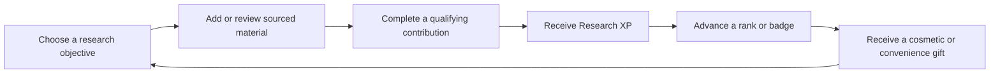
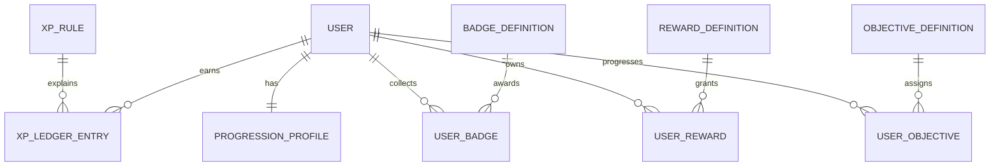
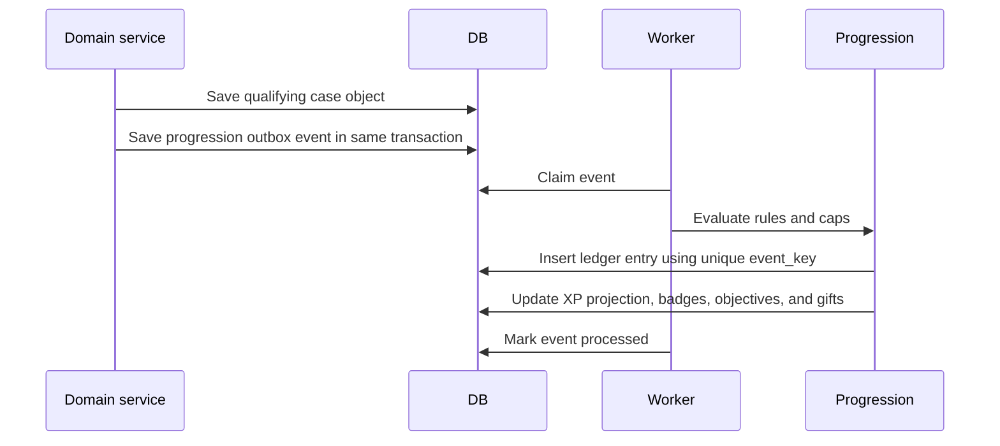

# Case Theory Progression System

Status: product and technical proposal. No application behavior, database schema, or subscription rule changes are authorized by this document.


## Product goal

The progression system should make Case Theory feel like a thoughtful investigation game without turning real cases, victims, or allegations into entertainment. Members earn Research XP by improving the quality, structure, and sourcing of the workspace. XP produces visible ranks, collectible badges, and feature gifts that match the research theme.

The system should encourage members to:

- cite reliable public sources;
- organize facts into timelines, evidence, people, and relationships;
- separate documented facts from theories;
- review AI suggestions before publishing them;
- collaborate constructively;
- return to unfinished research with a clear next objective.

It should not encourage members to create more accusations, upload sensational material, harass people, compete over victims, or spam low-quality objects.

## Product principles

1. **Reward quality over volume.** Creating an object alone should rarely be enough. Strong rewards require provenance, completion, confirmation, or useful feedback from another member.
2. **Keep progression separate from subscriptions.** XP and ranks never grant plan permissions, paid AI access, storage, case allowances, administrative controls, or access to private cases.
3. **Use respectful language.** Ranks describe activity inside Case Theory and must not imply law-enforcement authority, professional licensing, or factual certainty.
4. **Preserve uncertainty.** The system must never reward naming a suspect, asserting guilt, or presenting a theory as fact.
5. **Avoid public point competition at launch.** Personal progress and collections are the main loop. Global leaderboards would reward speed, controversy, and spam, so they are outside the initial scope.
6. **Make every award explainable.** Each XP entry records the event, rule, related resource, timestamp, and any reversal.
7. **Make awards idempotent.** Retrying an API request or worker job must never award XP twice.
8. **Respect accessibility preferences.** Progress animations must support reduced motion and never block the task the member is completing.

## The themed progression loop



The main terms are:

- **Research XP:** the permanent score earned from qualifying activity.
- **Research Rank:** a level calculated from lifetime XP.
- **Badge:** a collectible achievement for a specific kind of contribution.
- **Field Gift:** a cosmetic or convenience entitlement awarded at a rank or badge milestone.
- **Objective:** a short, optional prompt that teaches a useful workflow. Objectives are not daily chores and do not expire.

## Research ranks

The initial curve is deliberately easy to understand and increasingly difficult to advance. Thresholds belong in database-backed definitions so they can be tuned without deploying code.

| Rank | Lifetime XP | Theme | Initial gift |
|---|---:|---|---|
| Observer | 0 | Learning the workspace | Default case journal |
| Source Scout | 100 | Finding and recording public sources | Profile title selection |
| Timeline Analyst | 300 | Organizing dates and sequences | Personal timeline filters |
| Evidence Curator | 700 | Building a well-described evidence library | Evidence collection folders |
| Case Researcher | 1,400 | Connecting sources, events, people, and discussion | Research desk layout choice |
| Senior Researcher | 2,500 | Producing consistently useful sourced work | Additional journal theme and badge showcase slot |
| Archivist | 4,500 | Maintaining durable, well-structured case records | Archive profile frame and saved-view bundle |

Rank names are platform titles only. The UI should label them as “Case Theory rank” wherever confusion is possible.

The rank curve should be evaluated after the first cohort. Existing thresholds should not be raised in a way that demotes members. If thresholds change, store the highest rank already earned.

## XP award rules

The following values are starting points for product testing. “Daily cap” means the maximum XP from that rule in a rolling UTC day; the member may continue using the feature after reaching the cap.

| Event | XP | Qualification | Daily cap |
|---|---:|---|---:|
| Verify email | 20 | Awarded once | Lifetime event |
| Complete profile | 10 | Display name plus non-empty bio or avatar | Lifetime event |
| Follow the first case | 5 | Awarded once | Lifetime event |
| Add an external evidence link | 10 | Valid public URL, title, description, and available item | 30 |
| Complete an evidence upload | 12 | File passes storage validation and processing | 36 |
| Link evidence to a person | 4 | First unique evidence/person link | 20 |
| Add a sourced timeline event | 8 | Event has a date, useful description, and an evidence or public-source reference | 32 |
| Add a map location with provenance | 8 | Location has a source URL or linked evidence | 24 |
| Add a documented person | 6 | Useful summary and a linked source or evidence item | 24 |
| Create a sourced discussion thread | 6 | Body contains a linked evidence item or supported source | 18 |
| Receive a helpful reaction | 2 | One award per unique reacting member and resource | 20 |
| Contribution accepted by a case owner | 15 | First acceptance of that contribution | 45 |
| Review an AI suggestion | 3 | Explicit approve, edit, or reject decision | 18 |
| Complete a research objective | 10–30 | One-time objective with server-defined criteria | Objective-specific |

### Events that do not earn XP

- opening pages, logging in, or refreshing;
- creating private notes or private timeline entries;
- creating a case by itself;
- submitting reports or blocking users;
- posting unsupported theories or accusations;
- reactions given by the same member, the resource author, or a blocked account;
- AI generation before a member reviews the result;
- duplicate links, duplicate uploads, retry requests, or imported records without human review;
- content hidden by moderation or deleted before it qualifies.

Private notes and private timelines remain useful personal tools, but rewarding them would require the platform to score private writing and would create an easy spam path.

## Badges

Badges should track meaningful milestones rather than one-off clicks. Each badge has an icon, name, description, category, criteria version, visibility, and earned timestamp.

### Research craft

| Badge | Criteria |
|---|---|
| First Citation | Add the first qualifying public source or evidence link |
| Source Scout | Add 10 qualifying sources across at least 3 cases |
| Primary Record | Add 5 accepted government, court, or official records |
| Timeline Builder | Add 10 sourced timeline events |
| Chronology Keeper | Add 50 sourced timeline events across at least 5 cases |
| Evidence Curator | Add 25 qualifying evidence items with descriptions |
| Connection Mapper | Create 20 accepted evidence/person or person/person links |

### Quality and collaboration

| Badge | Criteria |
|---|---|
| Careful Reader | Review 10 AI suggestions, including at least 2 rejections or edits |
| Constructive Voice | Receive helpful reactions from 10 unique members on sourced discussions |
| Case Contributor | Have 10 contributions accepted by case owners |
| Collaborative Researcher | Contribute accepted work to 5 cases owned by other members |
| Archivist | Maintain 5 cases with sourced timelines, evidence, and people records |

### Badge tiers

High-volume badges can use Bronze, Silver, and Gold variants. Tier upgrades replace the lower visual treatment in the default showcase while preserving the full earned history. Badge names and icons should use notebooks, pins, folders, maps, clocks, source cards, and archive motifs. Avoid weapons, police shields, handcuffs, blood, suspect boards, or language about “solving” a real case.

## Field Gifts

Field Gifts are entitlements awarded through progression. They must be additive to the member’s subscription and must pass normal permission checks.

### Safe launch gifts

- profile titles chosen from earned ranks and badges;
- badge showcase slots on the member profile;
- journal cover and accent themes;
- avatar frames using archive, map, source-card, and timeline motifs;
- saved case-directory filters;
- saved personal workspace views;
- evidence collection folders;
- personal timeline filter presets;
- research desk layout choices;
- additional non-sensitive notification preferences.

### Gifts that are prohibited

- paid plan permissions or temporary access to them;
- additional case, AI, storage, collaborator, or message quotas;
- access to private cases or evidence;
- moderation or administrative controls;
- higher visibility in case rankings or search results;
- the ability to bypass review, evidence validation, or rate limits;
- boosts tied to controversial content, reactions, or public attention.

The entitlement service should resolve a capability as `subscription permissions + earned gifts`, but gift codes must come from a strict allowlist of cosmetic and convenience capabilities. Domain authorization must continue to use subscription permissions and case membership.

## Objectives

Objectives teach members how to build reliable case records. They should be finite, optional, and based on server-observed completion criteria.

Suggested first objectives:

1. **Open the Field Journal:** verify email, complete the profile, and follow one case.
2. **Build a Source Card:** add a public evidence link with a title and description.
3. **Place an Event:** create a dated timeline event and attach evidence.
4. **Connect the Record:** link an evidence item to a documented person.
5. **Separate Fact and Theory:** create a sourced question thread with neutral wording.
6. **Review the Researcher:** approve, edit, or reject a Researcher-created object.

Objectives should never ask members to identify a suspect, contact a person connected to a case, locate a private address, or upload graphic material.

## User experience

### Global shell

- Show the current rank and a compact XP meter in the account menu.
- Show a small, dismissible XP receipt after a qualifying action: `+8 Research XP · Sourced timeline event`.
- Use a single restrained rank-up animation with a reduced-motion version.
- Reveal a newly earned badge in a short, dismissible achievement card with the badge icon, name, reason it was earned, and a `View badges` action. The reveal must never block saving or navigating.
- Show each badge reveal once. If an award is processed after the member leaves the page or while the member is offline, deliver the same reveal from the unread notification on their next signed-in visit.
- Queue simultaneous badge, rank, and gift awards and show them one at a time rather than stacking animations.
- Open a Progression page from the account menu.

### Progression page

- current rank, lifetime XP, and progress to the next rank;
- next Field Gift with a plain-language description;
- earned badge collection and locked badge criteria;
- active one-time objectives;
- recent XP ledger entries with reasons;
- privacy controls for rank and badge visibility.

### Case workspace

- Show qualification hints near creation forms, such as “Attach evidence or a public source to qualify for Research XP.”
- Never show XP inside victim names, case titles, evidence viewers, or other areas where it would trivialize the material.
- A contribution should succeed even if the progression service is temporarily unavailable. The award can be processed later from the event receipt.

### Profiles

- Members may display one Case Theory rank and up to three earned badges.
- Every earned badge remains in the member's private collection even when it is not selected for the profile showcase.
- Rank and badge visibility defaults to signed-in members only.
- XP totals remain private by default; public profiles show the rank rather than the exact score.

## Technical design

Create a new `progression` backend domain instead of adding XP columns throughout existing case tables.

### Database model



Proposed tables:

#### `progression_profiles`

- `user_id` unique foreign key;
- `lifetime_xp` integer, never negative;
- `current_rank_code`;
- `highest_rank_code`;
- `show_rank` and `show_badges` privacy flags;
- `created_at`, `updated_at`.

`lifetime_xp` is a cached projection of the ledger. It can be rebuilt and must not be the source of truth.

#### `xp_rules`

- stable `code` such as `evidence.external.created`;
- display label and explanation;
- XP amount;
- daily cap;
- qualification version;
- active dates and enabled flag.

#### `xp_ledger_entries`

- user, rule, amount, and balance-after projection;
- unique `event_key` for idempotency;
- related resource type and UUID;
- case UUID when applicable;
- qualification metadata snapshot;
- `awarded_at`;
- optional reversal link and reversal reason.

Ledger rows are immutable. Corrections append a reversal row instead of editing history.

#### `badge_definitions` and `user_badges`

- stable badge code, category, tier, name, description, icon key, and criteria version;
- unique user/badge award;
- earned timestamp and the event that completed the criteria;
- optional revoked timestamp for moderation or invalidated activity.

#### `reward_definitions` and `user_rewards`

- stable reward code and allowlisted entitlement code;
- reward type: theme, profile title, showcase slot, saved-view allowance, layout, or collection;
- source rank or badge;
- unique user/reward grant and grant timestamp.

#### `objective_definitions` and `user_objectives`

- objective code, title, description, ordered criteria, XP reward, and enabled flag;
- per-user progress JSON snapshot, completion timestamp, and award event key.

### Award processing

Domain services emit a small progression event only after their primary transaction succeeds. Initial implementation can write an outbox row in the same transaction and let the worker process awards.



The award evaluator must:

1. load the rule version active at event time;
2. verify the actor and resource still qualify;
3. reject duplicate `event_key` values;
4. enforce per-rule caps transactionally;
5. insert the ledger row;
6. update the cached profile total;
7. evaluate rank, badge, objective, and gift thresholds;
8. create a notification for new ranks, badges, or gifts.

For actions already handled by workers, reuse the existing task infrastructure. Award failures retry independently and never roll back the primary case contribution.

### Event contract

```json
{
  "event_id": "uuid",
  "event_type": "timeline.event.created",
  "actor_user_id": "uuid",
  "case_id": "uuid",
  "resource_type": "timeline_event",
  "resource_id": "uuid",
  "occurred_at": "ISO-8601 timestamp",
  "attributes": {
    "has_evidence": true,
    "has_public_source": true,
    "ai_generated": false,
    "review_status": "published"
  }
}
```

Only server-derived attributes may affect XP. The browser may display expected XP but cannot submit an amount, rule code, qualification flag, badge, rank, or gift.

### API surface

| Method | Endpoint | Purpose |
|---|---|---|
| `GET` | `/users/me/progression` | Current XP, rank, next rank, gifts, objectives, and recent awards |
| `GET` | `/users/me/progression/ledger?cursor=` | Paginated personal XP history |
| `GET` | `/users/me/badges` | Full earned and locked badge collection |
| `PATCH` | `/users/me/progression/privacy` | Rank and badge visibility |
| `GET` | `/users/{id}/progression` | Public portion allowed by privacy settings |
| `GET` | `/progression/catalog` | Rank, badge, objective, and gift definitions |

Admin-only operations should support enabling rules, correcting a specific award through reversal, rebuilding a user projection, and viewing suspicious award patterns. They should not allow direct arbitrary edits to `lifetime_xp`.

### Frontend structure

```text
frontend/src/features/progression/
├── ProgressionPage.tsx
├── RankMeter.tsx
├── XpReceipt.tsx
├── BadgeCollection.tsx
├── ObjectiveList.tsx
├── GiftCollection.tsx
└── progression.test.tsx
```

The current-user response may include a compact progression summary for the navigation shell. Full collections and ledger history remain separate paginated requests.

## Abuse and integrity controls

- Apply XP only once per unique resource and rule.
- Normalize URLs and file hashes before evaluating duplicate evidence.
- Exclude self-reactions, repeated reaction toggles, blocked users, deleted accounts, and known test/admin automation.
- Require unique reacting or accepting members for social awards.
- Cap social XP more aggressively than source and structure XP.
- Delay reaction-based XP until the reaction survives a cooling period.
- Reverse XP when qualifying content is deleted, hidden by moderation, or found to be duplicated or fabricated.
- Flag rapid reciprocal reactions, repeated duplicate domains, repeated near-identical text, and coordinated acceptance patterns.
- Do not expose exact anti-abuse thresholds in the client.
- Rate-limit progression catalog and ledger endpoints like other authenticated endpoints.
- Store the rule version and qualification snapshot so an award can be audited later.

Moderators should see progression context when reviewing abuse, but rank must never influence whether a report is accepted or how a moderation decision is made.

## Subscription interaction

- Every signed-in member can earn XP from actions their current plan and case role already permit.
- Free members can earn onboarding, following, and any other XP attached to actions they are authorized to perform.
- Paid members may encounter more qualifying contribution types because their plans permit more creation tools, but XP itself does not improve plan access.
- A downgrade preserves ranks, badges, and gifts. A gift remains usable only if its entitlement is allowed independently of the restricted paid feature.
- Administrators do not earn XP from moderation, plan management, seeded data, scripted imports, or actions performed while impersonating/supporting another member.

## Analytics and success measures

Track aggregate product metrics without creating a public member leaderboard:

- percentage of active members earning XP from sourced contributions;
- percentage of new members completing the first objective;
- evidence items with descriptions and provenance;
- timeline events with linked evidence or sources;
- AI suggestions explicitly reviewed before publication;
- duplicate, deleted, hidden, and reversed awards;
- time from contribution to XP receipt;
- badge and gift usage;
- retention by rank while controlling for subscription tier;
- moderation reports per 1,000 rewarded contributions.

The launch is successful only if source quality and structured contributions improve without increasing moderation incidents or duplicate content.

## Delivery phases

### Phase 0: instrumentation

- Finalize names, rank thresholds, and initial XP rules.
- Add event contracts and idempotent outbox records.
- Run in shadow mode: calculate awards without showing or granting them.
- Audit false positives, duplicate events, and likely abuse for at least one release cycle.

### Phase 1: XP and ranks

- Add progression tables and seed rank/rule definitions.
- Process the safest events: email verification, profile completion, sourced evidence, sourced timeline events, and AI review.
- Add current rank, XP meter, XP receipts, ledger, and privacy controls.
- Backfill only deterministic lifetime events and qualifying existing resources.

### Phase 2: badges and objectives

- Add badge evaluation and collections.
- Launch the six introductory objectives.
- Add profile badge showcase.
- Measure whether criteria produce useful work rather than volume.

### Phase 3: Field Gifts

- Add the strict gift entitlement allowlist.
- Launch profile titles, themes, showcase slots, saved views, filters, and evidence folders.
- Test downgrade behavior and confirm gifts cannot bypass paid permissions.

### Phase 4: collaboration rewards

- Add accepted-contribution and helpful-reaction XP after abuse monitoring exists.
- Add reversal and suspicious-pattern tools to the admin area.
- Consider optional case-team milestones only after individual progression is stable.

## Testing strategy

- unit tests for every rule, cap, rank threshold, badge criterion, and gift allowlist entry;
- transaction tests proving duplicate events award once;
- concurrency tests for simultaneous events at a daily cap;
- reversal tests proving the ledger remains immutable and projections rebuild correctly;
- permission tests proving rewards never grant subscription or case-role capabilities;
- API tests for privacy, pagination, and current-user summaries;
- frontend tests for receipts, reduced motion, rank transitions, locked gifts, and error recovery;
- worker retry tests proving contribution creation succeeds even if award processing fails;
- migration and seed idempotency tests;
- abuse tests for self-reactions, reciprocal reactions, duplicate URLs, and moderated content.

## Decisions required before implementation

Recommended defaults are in bold.

1. Public progression visibility: **rank and selected badges visible to signed-in members; exact XP private**.
2. Global leaderboard: **do not build at launch**.
3. Rank naming: **use the seven research and archive names in this plan**.
4. Existing-content backfill: **award deterministic resource milestones only, with daily caps disabled for the one-time migration**.
5. Social XP: **defer until Phase 4**.
6. First gift set: **profile titles, journal themes, showcase slots, saved views, filters, and evidence folders**.
7. Seasonal progression: **defer; ranks and core badges remain permanent**.
8. Rank display on case content: **profile and account surfaces only**.

## First implementation slice

After this plan is approved, the smallest useful implementation is:

1. progression tables and seed definitions for ranks plus five safe XP rules;
2. an idempotent `ProgressionService.award(event)` with ledger and rank projection;
3. outbox events from email verification, profile completion, external evidence creation, completed evidence upload, and sourced timeline creation;
4. `GET /users/me/progression` and paginated ledger endpoints;
5. a compact account-menu rank meter, XP receipt, and Progression page;
6. shadow-mode configuration so production can measure awards before members see them.

Badges, objectives, gifts, social XP, public profile display, and backfill should follow after shadow-mode data confirms the rules behave as intended.
